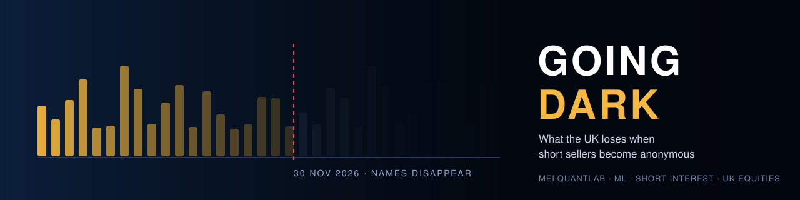
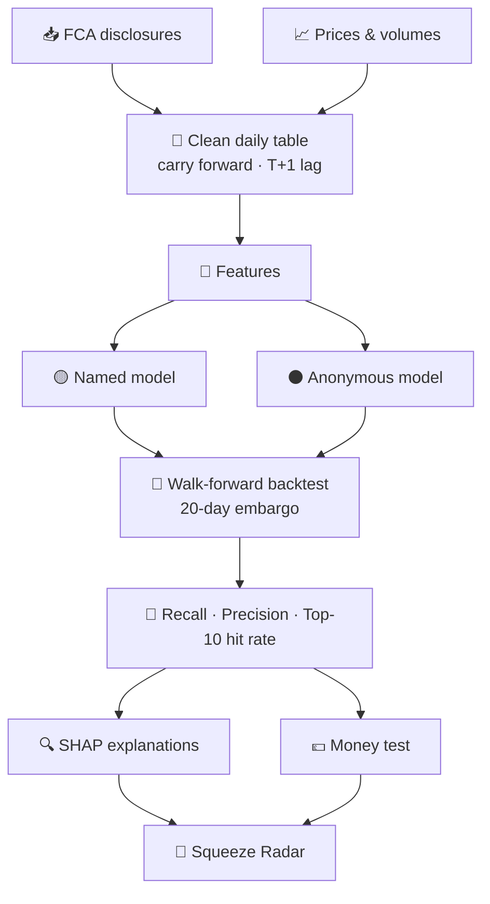
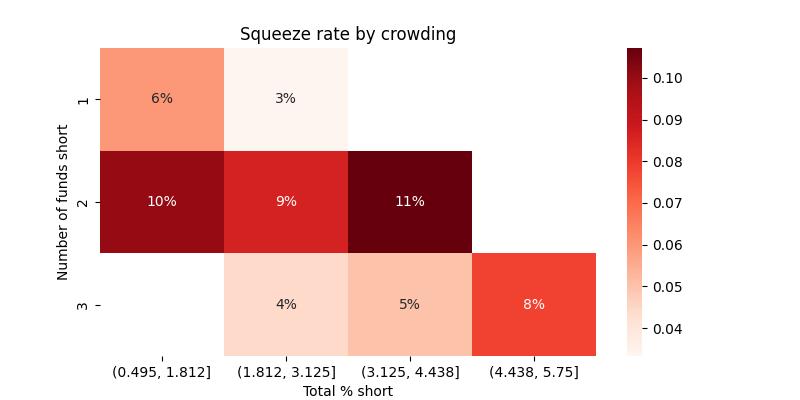
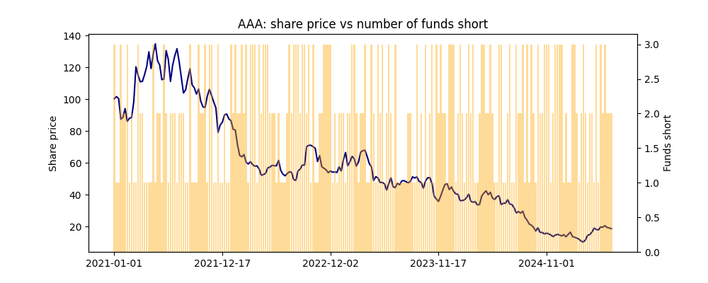

<p align="center">
  
</p>

<p align="center">
  
  
  
  
  
</p>

<p align="center">
  <b>For years, anyone could see which hedge funds were short which UK stocks.<br>
  On 30 November 2026, the names disappeared.<br>
  This project measures what that information was worth, and builds a radar that still works in the dark.</b>
</p>

<p align="center">
  <a href="#-the-story">Story</a> ·
  <a href="#-research-question">Question</a> ·
  <a href="#-who-its-for">Users</a> ·
  <a href="#-how-it-works">How it works</a> ·
  <a href="#-results">Results</a> ·
  <a href="#-dashboard">Dashboard</a> ·
  <a href="#-run-it">Run it</a> ·
  <a href="#-limitations">Limitations</a>
</p>

---

## ⚡ At a glance

| | |
|---|---|
| **The question** | Does knowing *who* is short predict short squeezes better than knowing *how much* is short? |
| **The moment** | The UK switches from named to anonymous short disclosure on **30 Nov 2026** |
| **The data** | 10+ years of FCA short disclosures, daily UK share prices, FTSE benchmarks |
| **The method** | Gradient boosting, walk-forward backtest with embargo, SHAP explanations |
| **The output** | A measured "transparency gap" and a live squeeze-risk radar |
| **The edge** | Built by a former Citi trader who priced stock loans for hedge-fund clients |

---

## 📖 The story

<table>
<tr>
<td width="33%" valign="top">

### 💡 The lights were on
Since 2012, the FCA has published every short position of **0.5% or more**, with the **fund's name**. Anyone could see when several funds were crowded into the same short.

</td>
<td width="33%" valign="top">

### 🌑 The lights go off
From **30 November 2026**, only **anonymous totals** per company are published. Who is short, and how crowded the trade is, becomes invisible.

</td>
<td width="33%" valign="top">

### 🔦 Working in the dark
This project measures the **transparency gap**, then builds a radar that flags squeeze risk using only what stays public.

</td>
</tr>
</table>

> [!NOTE]
> **Why crowding matters.** When many funds are short the same stock and the price starts to rise, they all rush to buy back at once. Their buying pushes the price higher still. That is a **short squeeze**, and it can cause large, sudden losses.

---

## 🎯 Research question

> ### Does knowing *who* is short, and how crowded a stock is with the same funds, predict short squeezes better than knowing only *how much* is short?

| | Hypothesis |
|:---:|---|
| **H1** | Fund-level information (number of funds, concentration, overlap, position age) improves squeeze prediction beyond total short interest |
| **H2** | The improvement is largest in smaller, less liquid companies |
| **H3** | Part of the lost signal can be recovered from data that stays public |

**The headline experiment** compares two models trained on identical market data:

| | 🟡 Named model | ⚫ Anonymous model |
|---|---|---|
| **Represents** | The old rules (before 30 Nov 2026) | The new rules (from 30 Nov 2026) |
| **Sees** | Fund-level crowding + shared market features | Aggregate short interest + shared market features |
| **The gap between them** | ⟶ **what the UK market loses** | |

---

## 👥 Who it's for

| | User | What they get | Why it matters |
|:---:|---|---|---|
| 🏦 | **Hedge funds and PMs** | A monthly list of the most crowded, highest-risk shorts, with reasons | Cut or hedge *before* the squeeze |
| 📊 | **Risk, prime brokerage and securities lending** | Early warning where borrow demand may spike or loans may be recalled | Better loan pricing, fewer client-risk surprises |
| 🏛️ | **Regulators, academics and journalists** | Evidence on what anonymous reporting costs | Policy debate grounded in data |
| 🎓 | **Investors and students** | A free, plain-English view of short-side crowding | Understand a hidden part of the market |

---

## ⚙️ How it works



<details>
<summary><b>1 · Clean daily table</b></summary>

- **Carry positions forward.** The FCA only records a row when a position changes, so each fund's latest position is carried forward daily (`ffill`) until it changes or drops below 0.5%.
- **No peeking.** Positions are published the day after the position date, so all short data is shifted forward one trading day.
- **Adjusted prices.** Splits and dividends are adjusted so corporate actions don't look like squeezes.

</details>

<details>
<summary><b>2 · What counts as a squeeze</b></summary>

Over the next 20 trading days, a stock is labelled a **squeeze** when it:

- **outperforms the FTSE 250** by an unusually large amount for its own volatility, **and**
- shows **falling** short interest at the same time, a sign of short covering.

</details>

<details>
<summary><b>3 · Features</b></summary>

| Feature | 🟡 Named | ⚫ Anonymous |
|---|:---:|:---:|
| Total % short and its change | ✅ | ✅ |
| Momentum, volatility, size, volume | ✅ | ✅ |
| Number of funds short | ✅ | — |
| Concentration (one fund vs many) | ✅ | — |
| Fund overlap and network crowding | ✅ | — |
| Funds joining or leaving | ✅ | — |
| Average position age | ✅ | — |

Both models share the same market features, so the comparison isolates the value of **fund identity**.

</details>

<details>
<summary><b>4 · Models</b></summary>

1. **Rule baseline:** highest total % short = highest risk
2. **Logistic regression:** transparent statistical baseline
3. **Gradient boosting:** main model

Balanced class weights handle the rarity of squeezes. `random_state=42` makes every result reproducible.

</details>

<details>
<summary><b>5 · Backtesting and metrics</b></summary>

- **Walk-forward:** train on all years up to *Y*, test on *Y+1*, roll forward.
- **20-day embargo** between train and test, so forward-looking labels can't leak.

| Metric | Question it answers |
|---|---|
| **Recall** | Of all real squeezes, how many were caught? |
| **Precision** | When it warns, how often is it right? |
| **Top-10 hit rate** | Of the 10 riskiest names each month, how many squeezed? |
| **Bootstrap range** | Is the gap real, or luck? |

> [!IMPORTANT]
> Accuracy is **not** a headline metric. Squeezes are rare, so a model that always says "no squeeze" would look highly accurate while catching nothing.

</details>

<details>
<summary><b>6 · Money test and explainability</b></summary>

- **Money test:** each month's top 10 flagged stocks vs the FTSE 250 over 20 days, after estimated trading costs.
- **SHAP:** shows *why* each stock was flagged, e.g. *"three overlapping funds · short interest rising · low volume"*.

</details>

---

## 📊 Results

> [!WARNING]
> **In progress.** No results are reported until they come from the full backtest on real FCA data. The charts below are **illustrative examples built on practice data** to show the planned outputs.

| Planned output | Status |
|---|:---:|
| Headline: squeezes caught, old rules vs new rules | ⏳ |
| Year-by-year transparency gap with bootstrap ranges | ⏳ |
| Crowding heatmap | 🧪 prototype |
| Fund network graph | ⏳ |
| Money test vs FTSE 250 | ⏳ |

<p align="center">
  
  
</p>
<p align="center"><sub><i>Illustrative only: practice data, not real FCA results.</i></sub></p>

---

## 📡 Dashboard

| Page | What you see |
|---|---|
| **📡 Radar** | Today's top 10 squeeze-risk stocks, each with a score and its three main reasons |
| **📈 Stock view** | Share price vs short interest over time, with past warnings marked |
| **🔬 Research** | Headline results and the fund network graph |
| **🤖 AI summary** | A one-paragraph summary of recent news for each flagged stock |

---

## 🗂️ Data

| Data | Source | Used for |
|---|---|---|
| Disclosed net short positions | FCA short positions daily update (historic tab) | Crowding and fund features |
| Backup disclosures | Investegate historical short positions | Gaps and cross-checks |
| Adjusted prices and volumes | Yahoo Finance via `yfinance` | Returns, volatility, labels |
| ISIN → ticker mapping | OpenFIGI | Linking disclosures to prices |
| Benchmarks | FTSE 250 and FTSE 100 | Market-relative returns |

> [!TIP]
> The named historical file was saved to `data/raw/` **before** 30 November 2026 and is never edited, so every result can be traced back to the original download.

---

## 🛠️ Project structure

```
going-dark/
├── assets/                    # banner and chart images
├── data/
│   ├── raw/                   # FCA file exactly as downloaded
│   └── clean/                 # daily table after cleaning
├── src/
│   ├── clean.py               # load, rename, carry forward, T+1 lag
│   ├── prices.py              # adjusted prices and volumes
│   ├── features.py            # crowding, network and market features
│   ├── model.py               # baselines, models, walk-forward backtest
│   └── charts.py              # matplotlib and seaborn charts
├── app/
│   └── dashboard.py           # Streamlit radar
├── tests/
│   └── test_no_lookahead.py   # no future data reaches training
├── requirements.txt
└── README.md
```

---

## ▶️ Run it

```bash
pip install -r requirements.txt

python src/clean.py        # build the daily table
python src/prices.py       # download prices
python src/features.py     # build features
python src/model.py        # run the backtest
python src/charts.py       # make the charts

streamlit run app/dashboard.py
pytest -q
```

---

## ⚠️ Limitations

| Limitation | What it means |
|---|---|
| **0.5% threshold** | Smaller short positions were never public |
| **No borrow-fee data** | Stock-loan fees and utilisation aren't freely available |
| **Survivorship** | Some delisted or acquired companies may lack free price data |
| **Inferred label** | Short covering is inferred, not directly observed |
| **Public data only** | Results describe what public information reveals, not private fund knowledge |

> [!CAUTION]
> This is a research and learning project, not investment advice.

---

## 🗺️ Roadmap

- [ ] **v1.1** · Clean daily table: carry forward, T+1 lag, 20-day embargo
- [ ] **v2** · Market-relative squeeze label, fair feature sets, logistic baseline, recall and precision
- [ ] **v3** · Gradient boosting, bootstrap ranges, SHAP, money test
- [ ] **v4** · Streamlit radar, fund network graph, AI news summaries, CI
- [ ] **📄 Paper** · Short working paper on SSRN

---

## 👩🏾‍💻 About the author

<table>
<tr>
<td>

**Mel Abim** · MSc Computer Science, University of Bath · MBA, Warwick Business School

Former Citigroup Sales & Trading (electronic trading and leveraged credit), where she priced stock loans for hedge-fund clients. Builds open-source quant and risk tools at **MelQuantLab**.

<a href="https://www.linkedin.com/in/mel-abim-mba-660201206"></a>
<a href="https://github.com/MelQuantLab"></a>
<a href="https://orcid.org/0009-0009-3338-223X"></a>

</td>
</tr>
</table>

<p align="center"><sub>If this project is useful, a ⭐ helps others find it.</sub></p>
